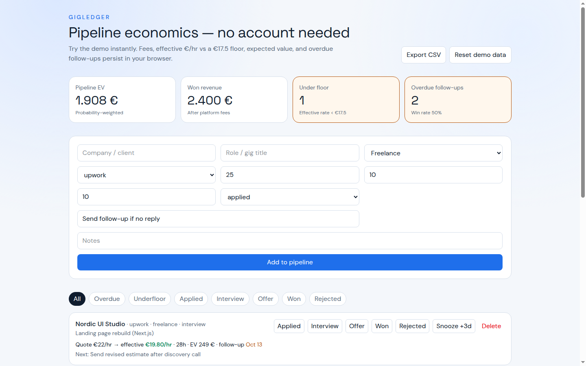

# GigLedger

**Real problem:** freelancers accept underpaid work and miss follow-ups because opportunities live in scattered notes.

**Solution:** a pipeline tool that tracks jobs/gigs with platform fees, effective hourly rate, expected value, and overdue follow-ups — **no account needed**.

## Mockup



## Live demo

https://stefandevelops.github.io/gigledger/

## Solves

- “Is this Upwork gig actually above €17.50/hr after fees?”
- “What’s my pipeline worth at current probabilities?”
- “Who do I need to follow up with today?”

## Stack

Next.js, TypeScript, Tailwind, localStorage

## Run locally

```bash
npm install
npm run dev
```

http://127.0.0.1:43121 — demo data loads instantly.

## CV line

Built a freelance pipeline tool that calculates effective rates after platform fees, expected opportunity value, and follow-up debt so freelancers stop accepting underpaid work.
